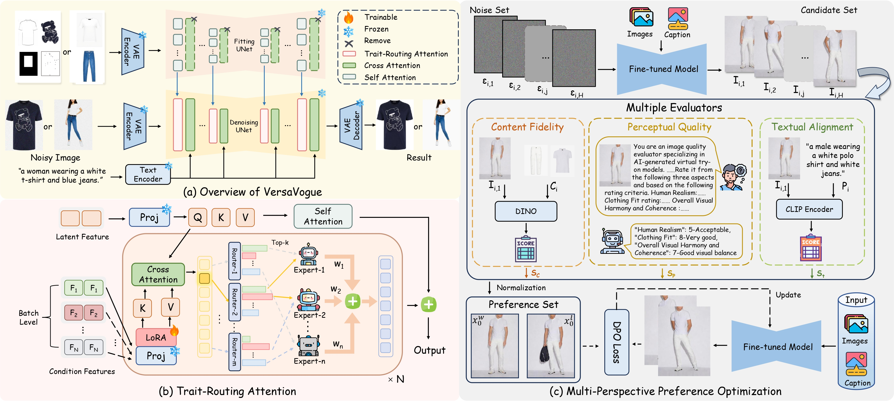

<div align="center">
<h1> VersaVogue: Visual Expert Orchestration and Preference  Alignment for Unified Fashion Synthesis </h1>

Jian Yu<sup>\*</sup> , Fei Shen <sup>\*</sup>, Cong Wang , Yi Xin , Si Shen ,  Xiaoyu Du<sup>†</sup> , Jinhui Tang

*These authors contributed equally , †Corresponding author

<a href='https://revive234.github.io/VersaVogue-Page/'></a>
<a href='https://arxiv.org/pdf/2604.07210'></a>
<a href='https://huggingface.co/keimen/IMAGGarment-Plus'></a>
[](https://github.com/revive234/VersaVogue)
</div>




## 🔧 Requirements

- Python>=3.8
- [PyTorch>=2.0.0](https://pytorch.org/)
- cuda>=11.8
```
conda create --name IMAGGarment-Plus python=3.8.8
conda activate IMAGGarment-Plus
pip install -U pip

# Install requirements
pip install -r requirements.txt
```
## 🌐 Download Models

Our method is built upon [Stable Diffusion XL (SDXL)](https://huggingface.co/stabilityai/stable-diffusion-xl-base-1.0), using [sdxl-vae-fp16-fix](https://huggingface.co/madebyollin/sdxl-vae-fp16-fix) as the VAE. The pretrained IMAGGarment+ checkpoint is available on [IMAGGarment-Plus](https://huggingface.co/keimen/IMAGGarment-Plus).

## 🚀 How to use
```
conda activate IMAGGarment-Plus
# Training
sh train.sh

# Inference 
sh inference.sh
```

## Citation
```bibtex
@article{yu2026versavogue,
  title={VersaVogue: Visual Expert Orchestration and Preference Alignment for Unified Fashion Synthesis},
  author={Yu, Jian and Shen, Fei and Wang, Cong and Xin, Yi and Shen, Si and Du, Xiaoyu and Tang, Jinhui},
  journal={arXiv preprint arXiv:2604.07210},
  year={2026}
}
```
